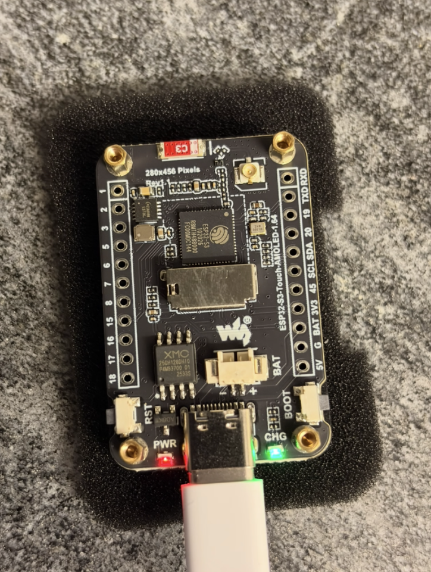
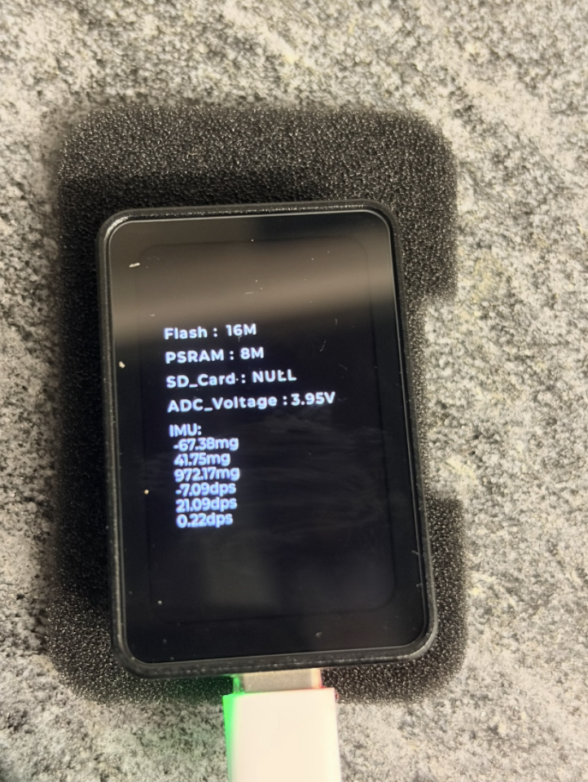

# Waveshare ESP32-S3 Touch AMOLED 1.64″ display v1.1

## Device

### Backside



### Frontside



### Vender

[AliExpress ESP-S3 touch](https://de.aliexpress.com/item/1005009056849529.html?spm=a2g0o.productlist.main.47.67f0360fOdbyAI&algo_pvid=6c84632c-953d-4c5a-8ffe-b1b2d5cd9d61&algo_exp_id=6c84632c-953d-4c5a-8ffe-b1b2d5cd9d61-46&pdp_ext_f=%7B%22order%22%3A%22205%22%2C%22spu_best_type%22%3A%22price%22%2C%22eval%22%3A%221%22%2C%22fromPage%22%3A%22search%22%7D&pdp_npi=6%40dis%21CHF%2125.53%2120.43%21%21%2130.05%2124.05%21%402103973d17919110698807743e0f10%2112000047747120286%21sea%21CH%210%21ABX%211%210%21n_tag%3A-29910%3Bd%3A98fffbe9%3Bm03_new_user%3A-29895%3BpisId%3A5000000219360538&curPageLogUid=I1evHqIttHfV&utparam-url=scene%3Asearch%7Cquery_from%3A%7Cx_object_id%3A1005009056849529%7C_p_origin_prod%3A)

## Display

touch display: 280 × 456 Pixel

 - display driver: CO5300
 - touch driver:   FT3168

## Connectivity

WLAN:          2,4-GHz-WLAN (802.11 ax/b/g/n) mit 40 MHz Bandbreitenunterstützung

Bluetooth:     Bluetooth 5 (LE) und Bluetooth Mesh

## OS

FreeRTOS version: V10.5.1

## Development

List all available boards for 'esp32':

```bash
arduino-cli board listall esp32
```

FQBN: esp32:esp32:waveshare_esp32_s3_touch_amoled_164

Arduino lib directory: /Users/mue/Documents/Arduino/libraries

[Arduino_GFX](https://github.com/moononournation/Arduino_GFX)

[LVGL 8.4 docu](https://lvgl.io/docs/open/8.4/)

### Arduino CLI

#### Compile
```bash
arduino-cli lib install "lvgl@9.4.0"
arduino-cli lib install "GFX Library for Arduino@1.6.9"
arduino-cli lib install "SensorLib@0.5.1"

arduino-cli compile --fqbn esp32:esp32:esp32s3:FlashSize=16M,PSRAM=opi,PartitionScheme=custom,CDCOnBoot=cdc \
  --output-dir ./build .
```

#### Transfer to the device
```bash
arduino-cli upload \
  -p /dev/cu.usbmodem101 \
  --fqbn esp32:esp32:esp32s3:FlashSize=16M,PSRAM=opi,PartitionScheme=custom,CDCOnBoot=cdc \
  --input-dir ./build .
  ```

### Per project lvgl config file

Put your lgvl config file into the project root:

lv_conf.h    (both from the example git repo)

and define LV_CONF_INCLUDE_SIMPLE just before including lvgl.h

```c
#define LV_CONF_INCLUDE_SIMPLE

#include <lvgl.h>
```

[Waveshare wiki](https://docs.waveshare.com/ESP32-S3-Touch-AMOLED-1.64)

[Waveshare peripheral tutorials](https://docs.waveshare.com/ESP32-Peripheral-Tutorials/Display/AMOLED)

[Git repo with firmware and examples](https://github.com/waveshareteam/ESP32-S3-Touch-AMOLED-1.64-v2)

[Demo widgets code](https://github.com/lvgl/lvgl/blob/master/demos/widgets/lv_demo_widgets.c)

[LVGL VSCode Simulator](https://github.com/lvgl/lv_port_pc_vscode)


### Flash the esp device

#### Device

Waveshare ESP32-S3-Touch-AMOLED-1.64

#### Menu / Tools
- USB DFU On Boot: Enabled
- Partision schema: 16M Flash (3MB APP/9.9 FATFS)

[ESPConnect web chromium](https://thelastoutpostworkshop.github.io/ESPConnect/)


### UI design tools

[LCD Wizard](https://app.lcdwizard.com/app/) (login with google id)

[EEZ Studio](https://www.envox.eu/studio/studio-introduction/)

[SquarLine Studio](https://squareline.io/)

### Videos

[ESP-C6 install libs ans develop an example with LVGL](https://www.youtube.com/watch?v=KEcr22qZAVE&t=12s)


## Query BTC price on Binance

https://api.binance.com/api/v3/ticker/price?symbol=BTCUSDT

```json
{"symbol":"BTCUSDT","price":"81350.01000000"}
```

[Binance API docu](https://developers.binance.com/en/docs/)

### Rate limits per IP

For the standard Binance Spot REST API, the commonly documented limit is 6,000 request-weight units per minute per IP, equivalent to a theoretical 360,000 units per hour if you could use the full allowance continuously. Confirm the current limit for your specific API using exchangeInfo, since limits can change.

You can also inspect the response headers from any API request:
- X-MBX-USED-WEIGHT-1M — weight used during the current minute.
- X-MBX-USED-WEIGHT-1S — if provided, weight used during the current second.

[bitcoin logo](https://www.svgrepo.com/svg/303287/bitcoin-logo)


## Query BTC price on Coingecko

GET request
```
https://api.coingecko.com/api/v3/simple/price?ids=ethereum%2Cbitcoin&vs_currencies=usd%2Ceur
```

response:
```json
{"ethereum":{"usd":2058.45,"eur":1839.14},"bitcoin":{"eur":65747,"usd":73587}}
```

## Fear and greed index

Documentation: https://alternative.me/crypto/fear-and-greed-index/

GET https://api.alternative.me/fng/

```json
{
	"name": "Fear and Greed Index",
	"data": [
		{
			"value": "29",
			"value_classification": "Fear",
			"timestamp": "1794355200",
			"time_until_update": "43918"
		}
	],
	"metadata": {
		"error": null
	}
}
```

time_until_update: is in seconds
